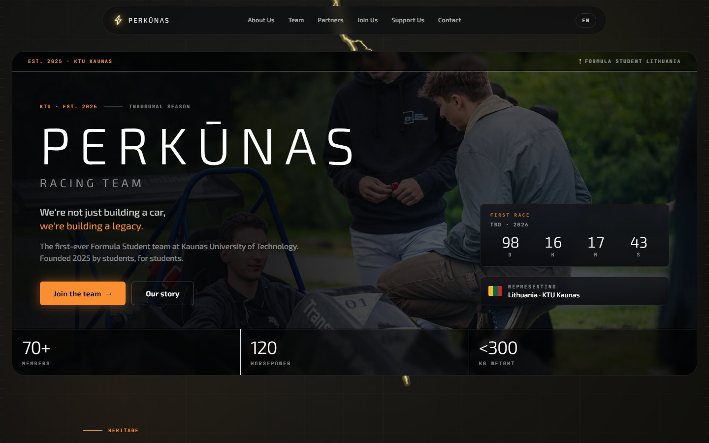
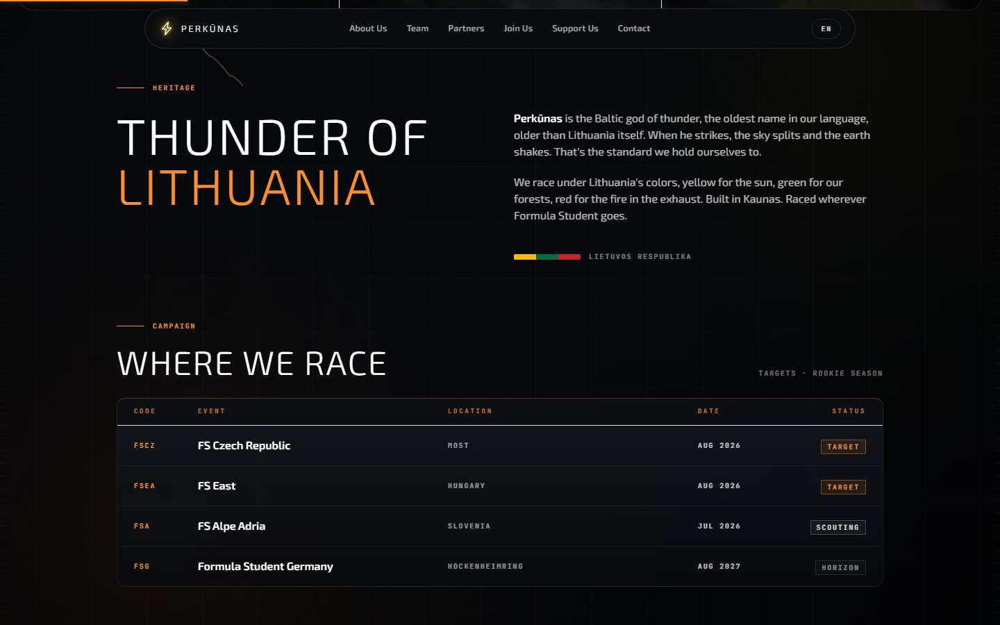
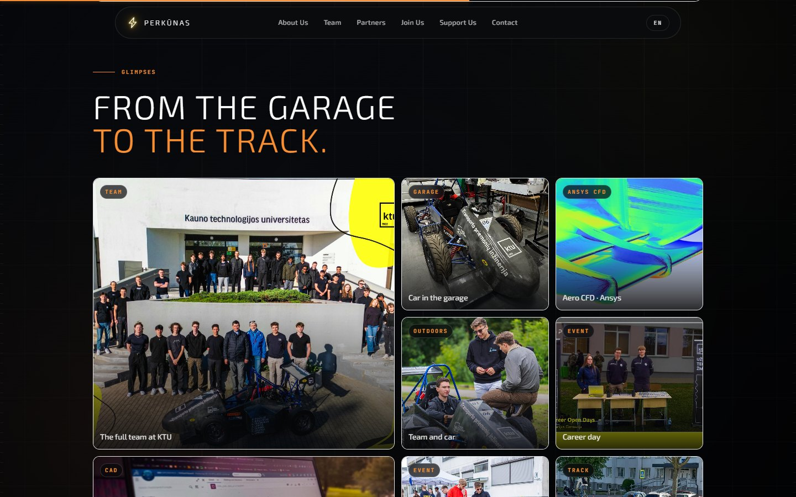
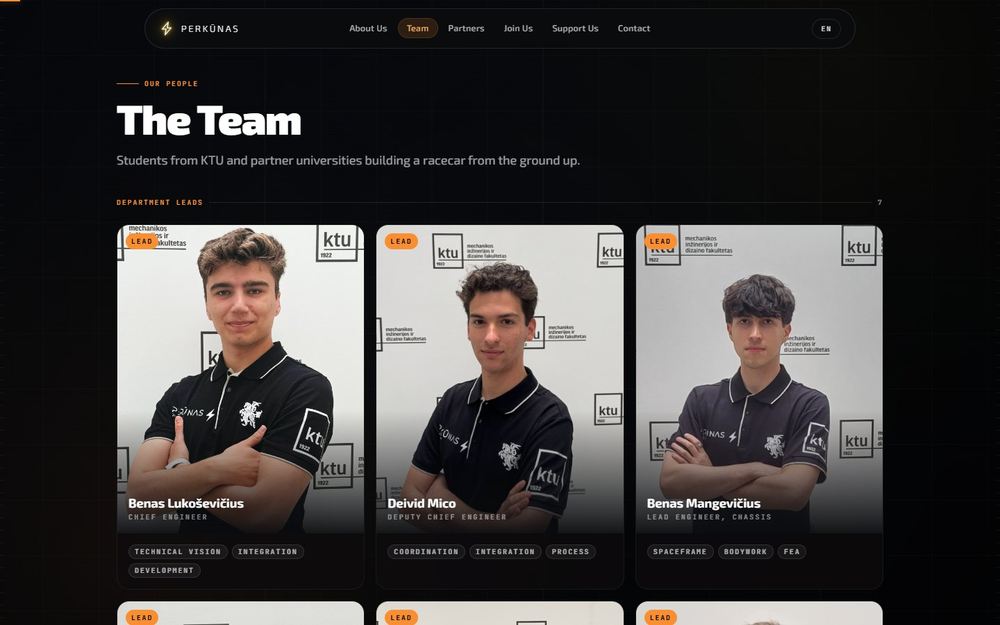
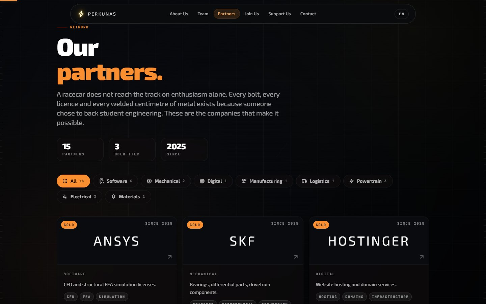
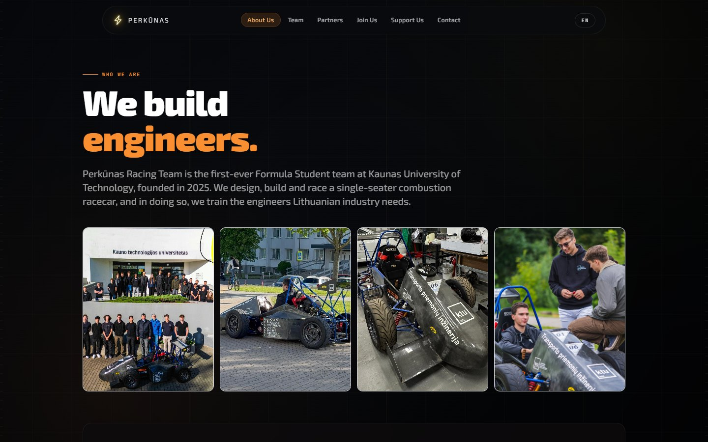
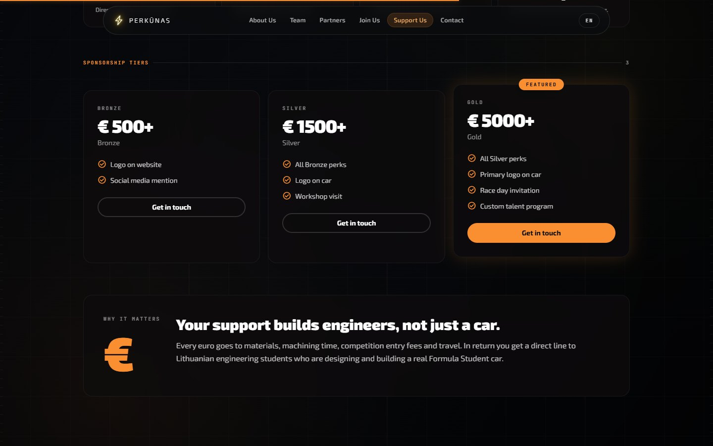
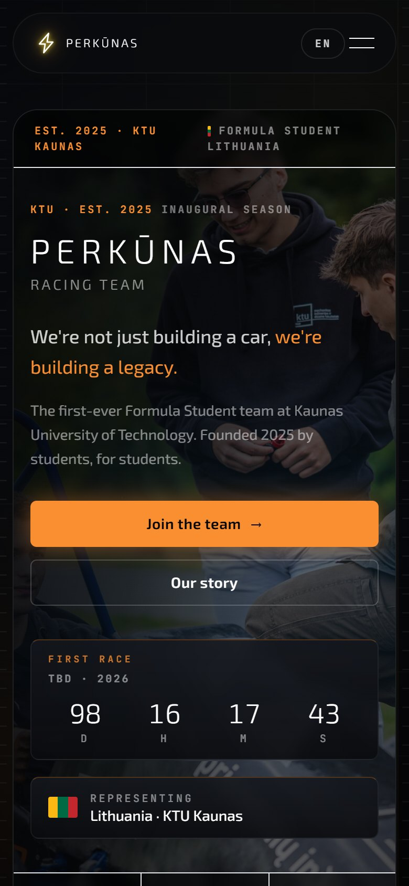
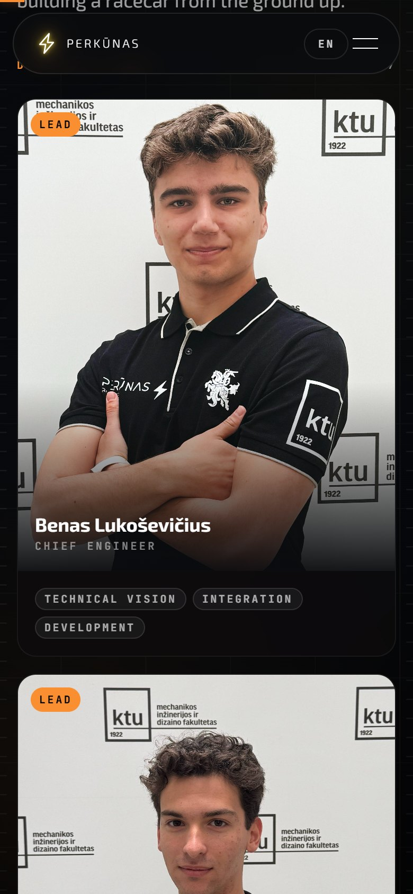
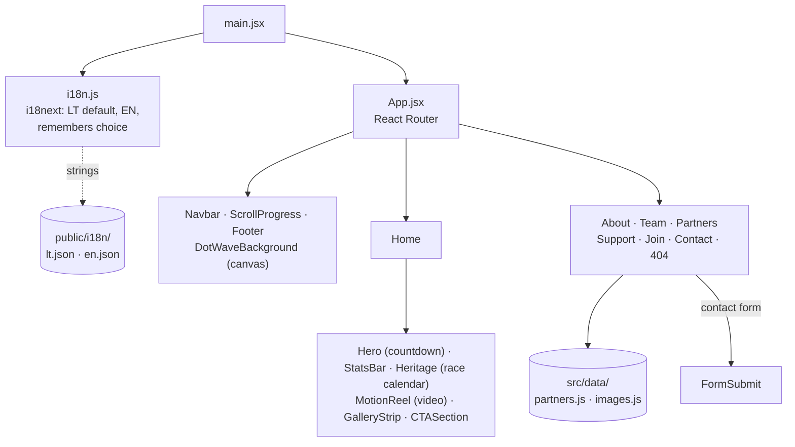

# Perkūnas Racing Team website

The website of **Perkūnas Racing Team**, the first Formula Student team at Kaunas University of Technology (KTU). The team was founded in 2025 and named after the Baltic god of thunder. The site is a bilingual (Lithuanian and English) React single-page app. It recruits students, presents the team and its car, and gives sponsors a reason to get involved.



## What's on the site

| Page | What it does |
|---|---|
| **Home** | Hero with a countdown to the first race, team stats, the team's story, a race calendar, video clips of the car and a photo gallery |
| **About** | Mission, values and a timeline from founding to the first competition entry |
| **Team** | Department leads with photos, roles and specialities, plus a "could be you" recruiting card |
| **Partners** | 15 sponsors with Gold, Silver and Bronze tiers, and filters by category (software, mechanical, powertrain, ...) |
| **Support** | Ways to help and the Bronze, Silver and Gold sponsorship tiers |
| **Join** | Engineering, software, business and fabrication tracks, the application process and an FAQ |
| **Contact** | Contact details and a validated form that sends through FormSubmit |

## Screenshots

### Home

| Heritage and race calendar | From the garage to the track |
|---|---|
|  |  |

### Team and partners

| Team | Partners |
|---|---|
|  |  |

| About | Sponsorship tiers |
|---|---|
|  |  |

### On a phone

<p>
  
  
</p>

<sub>Screenshots show the English version. The browser clock is set to launch day (26 April 2026) so the race countdown is running.</sub>

## How it's built



- **React 18 + Vite** for a fast dev server and hashed production builds.
- **Tailwind CSS** and **HeroUI** for styling and components, with a dark motorsport theme in the team's orange and Lithuanian flag colours.
- **Scroll reveals** with `IntersectionObserver` and Tailwind transitions. A scroll-progress bar runs along the top edge.
- **Canvas background** (`DotWaveBackground`): a faint racing-sector grid with timing-tower tick marks and the occasional branching lightning strike.
- **i18next**: every string has a Lithuanian and an English version. Lithuanian is the default, the browser language is detected, and the visitor's choice is remembered.
- **Data-driven pages**: partners, tiers and gallery images come from plain JS modules in `src/data/`, so adding a sponsor is a one-line change.

## Running it

```bash
npm ci
npm run dev       # dev server
npm run build     # production build in dist/
npm run preview   # serve dist/ locally
```

The site is static, so deploy it by uploading `dist/` to any web host. `public/.htaccess` is copied into the build. It sends every route to `index.html`, so deep links like `/team` work on Apache, and it sets long cache headers for the hashed assets.

## Project structure

```
src/
├── App.jsx                 routes and shared layout
├── i18n.js                 language setup
├── components/
│   ├── Navbar.jsx, Footer.jsx, ScrollProgress.jsx, BoltLogo.jsx
│   ├── DotWaveBackground.jsx
│   └── home/               Hero, StatsBar, Heritage, MotionReel, GalleryStrip, CTASection
├── pages/                  About, Team, Partners, Support, Join, Contact, NotFound
└── data/                   partners.js, images.js
public/
├── i18n/                   lt.json, en.json
├── images/, videos/        photos and car clips
├── brochures/              sponsorship brochures (LT, EN)
└── .htaccess               SPA routing and caching on Apache
docs/screenshots/           images for this README
```

## Possible improvements

- **Split the bundle.** The main JavaScript chunk is about 630 kB (168 kB gzipped). Lazy-loading the pages with `React.lazy` would make the first visit faster.
- **Season data.** The countdown and the race calendar point at the 2026 season, which has passed. Moving them into `src/data/` would make next season a data-only update.
- **Link the brochures.** The sponsorship brochures in `public/brochures/` aren't linked from any page yet. The Support page is the natural place for them.
- **Tidy up.** `legacy/`, `projects/` and `src/scripts/` are left over from earlier versions and aren't imported by the current app. Neither are the 3D concept models in `public/images/`, which only the old scripts used.

## Credits

Website by [Miglė Cirtautaitė](https://github.com/cmigle) for Perkūnas Racing Team · [Instagram](https://www.instagram.com/perkunas_racing_ktu/) · [LinkedIn](https://www.linkedin.com/company/perkunasrt/)
